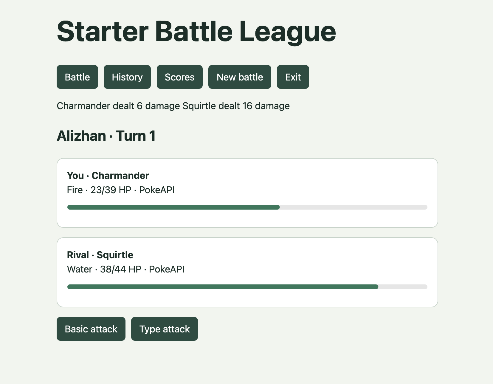

# Pokémon Battle League

My midterm was a battle between two Pokémon. For the final, I added trainer names, a battle history and a scoreboard. Now my classmates can play on the same laptop and keep track of who has the most wins.

## Demo

[Watch the 30-second battle](media/demo.mov)



## How to play

Pick Bulbasaur, Charmander or Squirtle. A basic attack always deals 10 damage. A type attack deals 16 if you have the advantage and 6 otherwise. The battle ends when one Pokémon reaches 0 HP.

Use the same trainer name each time to add to your score. Open **History** to see the last 30 turns or **Scores** to see wins and battles played. The results stay there after you close the app.

## How to run it

On a Mac, open Terminal in the project folder. Run these setup commands once:

```sh
python3 -m venv .venv
source .venv/bin/activate
python3 -m pip install -r requirements.txt
test -f .env || python3 -c 'from secrets import token_hex; print("SECRET_KEY =", repr(token_hex(32)))' > .env
```

To start the game:

```sh
source .venv/bin/activate
python3 main.py
```

Open http://127.0.0.1:8000/ in your browser. Press Control–C in Terminal to stop the server. You can also play in Terminal with `python3 main.py --console`.

## Tests

Run `python3 -m unittest -v test_battle`. The three tests check that invalid trainer names are rejected, attacks deal the right damage, and a knocked-out rival cannot attack back.

## Grading checklist

| Criterion | Points | Evidence |
| --- | ---: | --- |
| Design, menu and exit | 3 | Fighter cards, HP bars, New battle and Exit |
| Separate entry point | 1 | `main()` in `main.py` starts either menu |
| External storage and SQL | 3 | Turns and results are saved in `battles.db` |
| Tests for three functions | 1 | `trainer_name()`, `damage()` and `play()` |
| External API | 1 | PokéAPI supplies each starter’s type and base HP. Offline cards are available if the request fails. |
| Data structures and Python features | 3 | Dictionaries for fighters, a list for HP, a tuple for starters and a set for matchups. The scoreboard uses a lambda and a generator. API requests use a cache decorator. |
| Classes and inheritance | 3 | `TypeMove` inherits from `Move` and changes how damage is calculated |
| Validation and error handling | 2 | Trainer names are checked with a regex. Failed requests and duplicate turns are handled. |
| Code organization and documentation | 3 | 24 functions and methods across separate modules, short docstrings, files under 300 lines and functions under 80 lines |
| Restart inside the app | 1 | New battle returns to the starter menu |
| Logging | 1 | `game.log` records each move and result with a timestamp |
| GitHub and project files | 3 | Repository, `README.md`, `requirements.txt`, `.gitignore` and a private local `.env` |
| Demo video | 2 | Recording linked above |
| Merged pull request | 1 | `demo-guide` pull request once merged |
| On-time submission | 2 | Course submission timestamp |

Estimated total after publishing, merging the pull request and submitting on time: **30/30**.

## Project files

- `main.py`, `web.py`, `console.py` — startup and menus
- `battle.py`, `moves.py`, `game.py` — starter data, attacks and turns
- `history.py` — database, scores and logs
- `templates/index.html` — browser page
- `test_battle.py`, `media/` — tests, screenshot and recording

## Next improvement

I’d like to filter the history by trainer so each player can find their own battles.

## Author and credits

Alizhan Nurakhmetov · [GitHub](https://github.com/Alizhan-Nurakhmetov)

This project continues my [midterm](https://github.com/Alizhan-Nurakhmetov/Pokemon-battle). Pokémon data comes from [PokéAPI](https://pokeapi.co/). To report a bug, open an issue and mention which move or menu option you selected.
